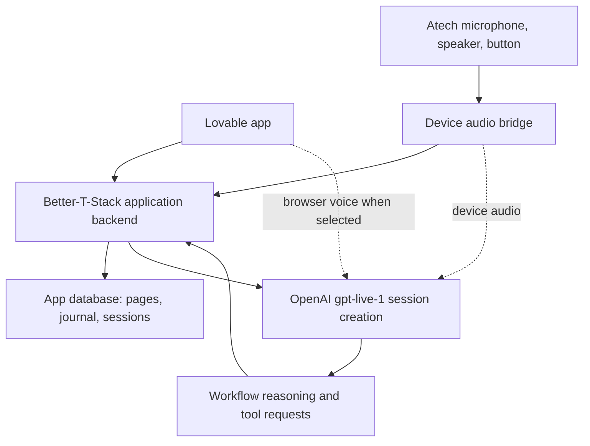

# Pink Hack product requirements

Draft for implementation. Product direction reflects the developer's 2026-10-24 clarification. This describes intended behavior, not a working release.

## Problem

A person managing the physical and mental effects of cancer after treatment needs an easy way to record how they feel and plan a manageable day. Repeated forms require effort when energy is low. Their preferences, medical context, and daily notes need to remain available across conversations.

The [event notes](docs/event-context.md) propose this companion. The developer now specifies a Lovable app, personal-needs and medical-needs pages, daily-journal database entries, and an Atech voice assistant connected to the same API.

## Goal

The user maintains their context in readable, editable pages. They can complete a guided check-in through the app or an Atech microphone and speaker. The assistant uses the saved context, creates a reviewable daily-journal entry, and suggests a day plan grounded in the user's stated needs. The resulting record appears in the app and survives refresh and reconnection.

Storage belongs to our app's backend. There is no Notion integration. "Notion-style" describes pages, navigation, and database views.

The developer selected a Better-T-Stack backend. The implemented foundation is a separate Hono/Node API in `backend/`, with Better Auth and Drizzle SQLite/libSQL. Lovable remains the frontend. [Backend setup and coverage](docs/backend.md) distinguish the running foundation from the full requirements below.

## Decisions and assumptions

| Item | Status |
| --- | --- |
| Lovable is the app platform | Confirmed by project context and event requirements |
| `gpt-live-1` handles the spoken conversation | Developer requirement; project access still needs a live test |
| Our app backend owns pages and journal records | Confirmed by developer; no Notion API |
| App and Atech share one application API | Developer requirement |
| Backend uses Better-T-Stack in this checkout; Lovable is the external frontend | Confirmed by backend owner coordination; scaffold and integration owned by that thread |
| "Persona needs" means the user's personal needs and preferences | Working interpretation |
| Atech carries microphone input and speaker output | Required voice outcome; exact modules and audio path unverified |
| A laptop bridge connects Atech audio to GPT-Live initially | Proposed implementation; standalone Atech capability is unverified |
| A daily journal can contain multiple entries per day | Proposed; avoids overwriting morning and evening notes |

## How this fits the project

The local checkout currently contains planning documents. Lovable MCP inspection on 2026-10-24 verified test project `1c721b93-c6e1-407b-a22d-91efc06d322b` at commit `3c3ceacb5a0a02511eea619e6df59e38203e7246`.

The developer has reviewed and accepted the [Today-first design](docs/superpowers/specs/2026-10-24-today-first-companion-design.md). This PRD retains Today, Journal, Patterns, and About me navigation. Personal needs and medical needs sit within About me. The latest request makes Atech voice part of the required integration, extending the original optional voice route. The [implementation plan](docs/implementation-plan.md) sequences the manual app workflow and parallel voice readiness without dropping device acceptance or duplicating the backend owner's work.

| Owner | Verified today | Proposed change |
| --- | --- | --- |
| Lovable `src/routes/index.tsx` | Blank placeholder | Today page and check-in entry point |
| Lovable `src/routes/__root.tsx` | Router outlet and Query provider | Shared navigation and authenticated app layout |
| Lovable `src/components/ui/` | shadcn/ui components | Page forms, journal table, review panel, voice status |
| Lovable TanStack Start runtime | TypeScript and server entry exist | External frontend calls the shared Better-T-Stack backend |
| Local Better-T-Stack backend | Hono/Node, Better Auth, Drizzle SQLite/libSQL; eight synthetic-data tests, type checks and build pass | Connect Lovable; configure and test direct GPT-Live access; add device integration and remaining product routes |
| Database | Lovable reports `enabled: false`; local backend database not yet verified | Backend owner provisions app storage and enforces per-user access |
| Voice and Atech | No integration found in inspected files | Shared voice workflow plus device audio bridge |

The supplied Lovable project is a test project. Inspect team ownership before making changes there. A separate backend thread owns local scaffolding, dependencies, and integration; this PRD thread owns requirements and contracts. Full contracts and proposed file ownership are in [app structure](docs/app-structure.md).

## App experience

| Page | User can do |
| --- | --- |
| Today | Read today's saved entries and day plan; start or resume a check-in |
| Personal needs | Edit preferred name, communication preferences, routines, priorities, support needs, and activities that help |
| Medical needs | Record self-reported treatment context, symptoms to track, care-team instructions, and questions for their care team |
| Daily journal | Browse entries in a table sorted by local date; filter by date or source; open an entry as a page |
| Journal entry | Review and edit the note, reported symptoms, energy, mood, and suggested day plan |
| Patterns | Inspect explicitly confirmed observations and open their source journal entry; missing days remain gaps |
| Assistant | Start, stop, or reconnect voice; read connection state and review pending changes |
| Settings and device | Set timezone, pair or revoke Atech, and choose whether voice may use medical context |

Pages use a sidebar, titles, readable sections, and simple editing. Journal records have table properties and a page body. Full Notion editor parity is unnecessary for this flow.

## Architecture

The API owns authentication, workflow state, validation, record writes, and server-side credentials. GPT-Live owns the conversation. The workflow layer handles deeper reasoning and requests named application tools. Clients execute or relay tool calls through the authenticated API and return verified results to the voice session. The assistant only announces a saved entry after a successful storage response.

The app database is the source of truth. It stores original journal text, confirmed observations, and accepted day plans separately. The assistant reads the current page revisions and recent saved entries. A session records which revisions it used. Stopping a voice session leaves a resumable draft; it does not imply a completed journal entry.

## Guided check-in

1. The user starts voice on Atech or starts a check-in in the app. The backend resolves the authenticated owner and permitted device.
2. The assistant reads personal needs and, when the user has enabled it, medical needs. It asks about today's priority, energy, mood, and relevant symptoms, one question at a time. The user can skip a question or add a freeform note.
3. The workflow creates a draft with the user's reported observations, a readable note, and an optional manageable day plan. It uses preferences and existing care instructions without inventing clinical facts.
4. The app displays the draft. Atech reads a concise summary and offers save, correct, or cancel. The user can request changes before saving.
5. On explicit confirmation, the backend saves the confirmed draft revision exactly once. The app opens the journal entry. Atech announces the successful save and ends or returns to idle.

Example: "I slept badly and have little energy. I still want to see my sister." The assistant records the report, asks what support would help, and proposes a shorter visit with rest if the user wants a plan. It does not infer a clinical readiness score or alter treatment instructions.

## Requirements

### Pages and storage

- Personal needs and medical needs load from the authenticated user's saved pages. Edits survive refresh and carry a revision number.
- Medical context identifies user reports and care-team instructions separately. Generated suggestions never become medical facts automatically.
- Preserve the user's original writing or selected spoken text alongside the edited journal note. Extraction suggests observations for review; only confirmed observations drive Patterns.
- Journal entries include owner, local journal date, UTC creation time, source, session or capture ID, structured observations, note, and context revisions. Unknown observations remain empty.
- Morning and evening entries can coexist. Retried saves with the same operation ID return the existing result.
- Concurrent edits produce a revision conflict and preserve the current saved version. The app reloads it for review.
- A new plan remains a draft until accepted. It never overwrites a previously accepted plan without the user's choice. Observation points open their source entry; coverage and missing data remain visible.

### Voice and workflow

- App and Atech use the same API operations, schemas, and owner checks. The model never selects another user's destination.
- `gpt-live-1` session creation uses the documented Live API. The project key remains server-side.
- The assistant can retrieve context, prepare and revise a draft, and request save confirmation. The API checks confirmation against the current draft revision.
- Stopping, interrupting, disconnecting, or canceling prevents an unconfirmed write. A reconnect reloads backend workflow state.
- App status and Atech indicators distinguish idle, connecting, listening, thinking, speaking, review, saved, and error. Device firmware capability must be verified before indicator claims.
- Atech voice acceptance requires actual microphone input and audible speaker output. A browser microphone test is a separate test stage.
- Use the [Atech firmware guide](docs/atech-firmware-guide.md) for editor setup, component selection, proposed device controls, and the self-contained firmware prompt. Confirm the hardware map before generation.

### Recovery and access

- All stored user data and device operations require authenticated ownership. Another user cannot read pages, drafts, entries, or device sessions by changing an ID.
- Failed storage leaves the draft available and reports "not saved" with retry. Invalid voice access reports a connection error without pretending the assistant is active.
- The app offers text entry when the user cannot use voice. Device disconnection is visible and permits resume when the connection returns.
- Raw audio is not stored by our application by default. The app explains the context sent to OpenAI and persists only selected journal content and necessary session metadata. Provider retention must be checked separately before real patient use.

### Medical boundaries

- The assistant organizes self-reports and supports daily planning. It does not diagnose, recommend medication changes, or claim a measured body battery.
- Medical questions retain the user's wording and direct treatment decisions to their care team. A reported immediate emergency receives a brief instruction to seek urgent local help.
- Use synthetic personal and medical data for integration tests and the demo.

## Build and acceptance order

| Outcome | Evidence required |
| --- | --- |
| GPT-Live readiness alongside the manual app workflow | Authorized project creates a session, exchanges real audio, returns a tool result, and closes the session; storage integration uses the shared backend contracts |
| Pages and journal storage | User edits each context page; saves a journal draft; refresh retrieves the saved content |
| Guided app flow | New synthetic scenario follows context read, check-in, draft, correction, confirmation, saved entry |
| Atech integration | Real device speech follows the same flow; speaker confirms the saved entry visible in the app |
| Failure handling | Cancel causes no save; retry creates one entry; reconnect resumes; stale revision conflicts; foreign-owner access fails |

The [API readiness report](docs/api-readiness.md) records current evidence. A demo candidate requires the real end-to-end acceptance path, not only a passing build.

## Proposed later work

HealthKit imports, medical diagnosis, clinical scoring, automated medication reminders, clinician access, and a standalone device runtime require separate requirements. They are not acceptance criteria for this specification. This preserves the requested pages, journal, and Atech voice flow; any later cut to that flow requires a developer decision.

## Remaining decisions

- Confirm the exact Atech board, connected modules, gateway project, and audio capability. The laptop bridge is proposed until those facts are verified.
- Supply GPT-Live project access through the implementation platform's private secret configuration. API access and real audio remain untested until then.
- Confirm whether the supplied Lovable test project is the build destination or remains an isolated connection test.
- A product name, team names, and final submission link remain unset. Event deadlines and submission route are in [status](status.md).
