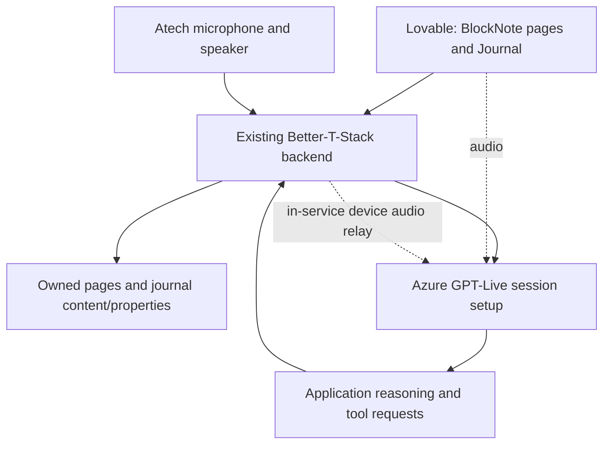

# Pink Hack product requirements

The developer's flexible-pages correction on 2026-10-24 supersedes the earlier fixed Today, About me, Patterns, page kinds, observation metrics, and separate day-plan model. [The coordinator brief](docs/flexible-pages-journal.md) is the current product direction. This PRD defines the build against that direction; it does not claim complete implementation.

## Problem and goal

A person should be able to describe their needs in their own pages and have the assistant use that context when helping with a check-in or day plan. Fixed page types and questionnaires restrict what they can record. A person managing fatigue after cancer treatment is the [event's example audience](docs/event-context.md); their needs determine the content and journal properties.

Build a simple Notion-style app with user-created pages and one fixed Journal database. Each Journal row has flexible properties and an editable page body. The assistant uses all owned context pages, guides a conversation, and creates or changes journal content after explicit user confirmation. A day plan is ordinary content inside the journal entry's page body.

Storage belongs to our backend. There is no Notion integration. Lovable is the frontend; the existing Better-T-Stack Hono/Node backend owns authentication, storage, and the shared API for the app and Atech.

## Product decisions

| Decision | Status |
| --- | --- |
| Custom context pages can be added, renamed, edited, and removed | Developer requirement |
| Sidebar contains custom pages and one Journal database | Developer requirement; fixed product sections are superseded |
| Journal properties are generic JSON values appropriate to the user's pages | Developer requirement; no compulsory metric scale |
| Journal and context pages use BlockNote native block JSON | Agreed editor recommendation; frontend compatibility still needs integration checks |
| Day plan lives in journal entry content | Developer requirement; no active separate plan resource |
| Voice agent handles most journal creation and changes after confirmation | Developer requirement; app also supports direct editing |
| App and Atech use the same authenticated backend | Developer requirement |
| One deployed demo backend owns the device audio relay | Latest Atech instruction; fixed HTTPS/WSS connection, no laptop bridge or environment selector |
| Azure `gpt-live-1` is the configured voice provider | Real root-`.env` startup and graceful-close probe passed |
| Canonical Lovable testing project | `ee916e8c-7f2f-4989-9c6e-cedcff1793b5`, Jonas' workspace |

Personal needs and medical needs are examples of pages the user can create. They are not required page kinds. An energy value from 1 to 5 can be a user-chosen property; the prior fixed energy schema is not a product requirement.

## Current owners and implementation

| Owner | Current evidence | Required change |
| --- | --- | --- |
| Backend thread, Integrate GPT Live Into Lovable | Hono/Node, Better Auth, Drizzle SQLite/libSQL, twelve prior-contract tests, type checks, build, and local HTTP smoke checks reported passing | Generic pages and journal content/properties; confirmed create/update tools; explicit legacy migration; application reasoning callback |
| Sole Lovable frontend worker | Assigned all remote edits in the canonical sandbox | BlockNote pages, simple sidebar, Journal table/page, auth and API wiring, reusable voice client |
| PRD/API thread | Azure Live session started and closed cleanly with confirmed model `gpt-live-1` | Shared contracts, reconciliation, sanitized probe evidence |
| Atech thread | Firmware/bridge guide exists; hardware/audio not verified | Align prompt to generic content and verify actual microphone/speaker transport |
| Coordinator | Owns correction brief, target, remote-writer assignment, and status | Integration and demo reconciliation |

[Backend documentation](docs/backend.md) records actual implemented routes. Prior foundation tests verify the earlier fixed schema, not this correction. [App contracts](docs/app-structure.md) define the agreed target. [The implementation plan](docs/implementation-plan.md) sequences the existing owners.

## App experience

The sidebar lists the user's pages, an Add page action, and Journal. The selected page has a title and the standard BlockNote editor. The app persists native block JSON and reloads that JSON into the same editor. It derives model-readable text from saved content; that text is not a second editable copy.

Journal is a table of saved entries. Its system date/title/source remain metadata; parameter columns come from stored flexible properties. Opening a row opens its page body in the same editor. A Day plan heading, paragraphs, lists, or checkboxes can appear there when the user asks for a plan. The app does not require a separate plan-acceptance screen or multi-stage check-in form.

Voice controls show connection, pending changes, successful saving, and errors. The person can review the proposed content visually or hear a concise summary, correct it, and confirm by voice. Direct page editing and text capture remain available.

## Architecture

The backend owns authenticated destinations, record validation, revision checks, confirmation receipts, and idempotent writes. Its single deployed service also owns the Atech audio relay and fixed authenticated WSS ingress. The assistant requests application tools and reports their verified result. Page content supplies context, not permissions.

The backend database is authoritative. New context pages have no kind enum. Journal entries store BlockNote content and properties directly. Existing legacy context, observation, and day-plan data remains available for explicit migration/audit; it is not an additional active product model.

## Conversation and save flow

1. The user starts the assistant. The backend resolves the authenticated owner and check-in session.
2. The assistant reads all live owned custom pages and their revisions, plus relevant recent journal history. It asks questions appropriate to those needs, one at a time, without forcing a fixed questionnaire.
3. It prepares a journal draft with title, selected original user text, generic properties, and BlockNote content. A requested day plan is included as ordinary blocks.
4. The person reviews or hears the draft, asks for corrections, then explicitly confirms the current proposal. The authenticated client records that confirmation separately from model tool execution.
5. The voice agent commits with the backend's matching receipt. The backend creates or updates the bound entry once and returns the saved revision. The assistant announces success only then.
6. Changing an existing day plan creates a new update proposal bound to that entry and revision. It preserves unrelated content. A saved check-in remains terminal.

Example: a page asks to track sleep and nausea, and another describes what helps on a difficult day. The assistant uses those pages to create suitable properties and a readable entry with a manageable plan. Another user can track different needs without a database migration.

## Requirements

### Pages and journal

- Users can create arbitrary titled pages, edit native blocks, and retrieve the same content after refresh.
- All live owned context pages are available to the assistant. Category filters must not silently exclude pages. If context limits prevent complete inclusion, the workflow reports that and retrieves or summarizes content with revision provenance.
- Journal properties accept bounded text, number, boolean, null, or lists of those values. Missing properties remain absent.
- Journal content is native BlockNote JSON. Day-plan changes update the relevant blocks while preserving the rest of the entry.
- Morning and evening entries can coexist. Local journal date is distinct from UTC timestamps.
- Page and journal updates carry expected revisions and stable operation IDs. Omitted fields remain unchanged; stale edits preserve the saved version and return a conflict.
- Legacy data is preserved and migrated explicitly. New writes use the generic product model, without silently converting old metric values.

### Voice and confirmation

- App and Atech call the same authenticated services. Neither a requested owner ID nor instructions in a page can change the destination.
- The agent can retrieve context, prepare new or update drafts, and commit a confirmed proposal. It cannot mint its own confirmation receipt.
- Confirmation binds owner, check-in, draft revision, create/update action, target entry revision, and save operation. Revising the proposal invalidates the earlier receipt.
- Duplicate commits return the original result. Reusing an operation ID with a changed payload conflicts.
- Cancel, interruption, disconnect, or an unrelated utterance cannot confirm a pending write. Failed saves retain a reviewable proposal.
- GPT-Live credentials stay on the backend. Client delegation needs a real application reasoning callback using current backend state and cancellation.
- Atech acceptance requires actual microphone input and audible speaker output. Browser voice is a separate test stage. Follow [the firmware guide](docs/atech-firmware-guide.md) and confirm the hardware map before generation.

### Access and feedback

- All record and device operations enforce authenticated ownership. Foreign-owned records are inaccessible.
- The app distinguishes unsaved, saving, saved, and failed states. A provider connection does not imply that the journal agent or save succeeded.
- Starting voice explains that custom pages are used as context. Existing explicit privacy choices must be reconciled with the all-page model rather than silently overridden.
- Our app stores no raw audio by default. Use synthetic personal/medical data for integration and demo checks.
- The assistant supports self-reports and planning. It does not diagnose, change treatment, or claim a clinical readiness score.

## Acceptance and current gaps

| Outcome | Required evidence |
| --- | --- |
| Generic page editor | Create unfamiliar titled pages, save blocks, reload, and verify owner isolation |
| Flexible Journal | Save unfamiliar properties and content; reopen the same row/page without a schema change |
| Context-based voice flow | Assistant uses newly created pages, prepares appropriate content, receives explicit confirmation, and persists it |
| Existing-entry change | Voice updates a Day plan inside the page, preserving unrelated content and rejecting a stale target revision |
| Recovery | Cancel writes nothing; replay saves once; failed writes retain drafts; interruptions cannot confirm |
| Atech | Real device speech follows the same path and the app retrieves the saved record |

The Azure access-only probe passed. Backend-mediated WebRTC, real audio, application reasoning/tools, generic persistence, Lovable integration, and Atech still need their own evidence.

The backend currently runs locally at `http://localhost:3000`. Deployment of one demo service is authorized and underway with its owner. No verified public HTTPS API URL or device WSS contract has been supplied yet. The owner supplies one reachable origin, exact allowed frontend origin, fixed device messages and audio format, and authenticated demo-device binding. The canonical Lovable project is for testing; a submitted demo candidate has not been established.

HealthKit imports, clinician access, clinical scoring, multi-database builders, and advanced editor collaboration need separate requirements. They are not acceptance criteria for this simple pages-and-Journal app.
